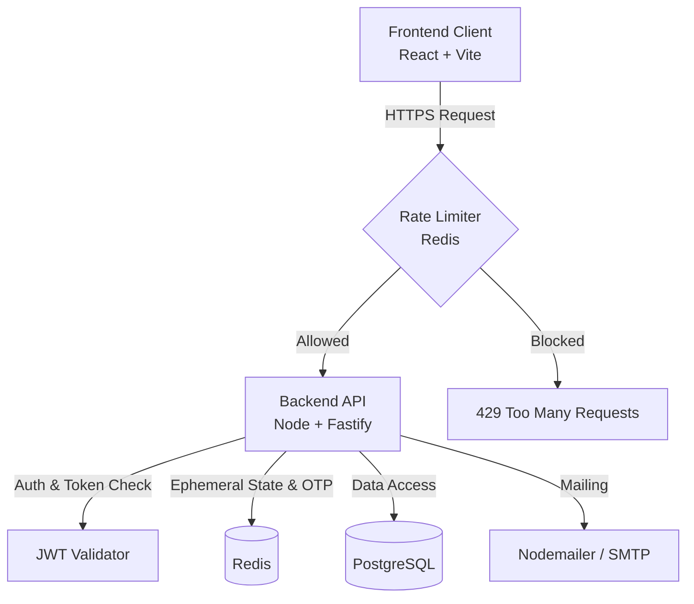

# SecureAuthProject

## Core Concept
**SecureAuthProject**
*A robust, minimalistic authentication application.*

This project implements a secure, defense-in-depth authentication structure featuring Role-Based Access Control (RBAC), OTP verification, robust rate limiting, and session security. It is built to minimize the attack surface and resist common vulnerabilities.

## Architecture



## Technologies Used

### Frontend
- **React + Vite**: High performance, minimal bundle, excellent developer experience.
- **TypeScript**: Type safety for frontend logic.
- **Tailwind CSS + Framer Motion**: Efficient, utility-first styling and smooth animations.

### Backend
- **Node.js + Fastify**: Chosen for extremely low overhead, high throughput, and strict JSON schema validation, minimizing injection vectors.
- **TypeScript**: Strict type safety.
- **Drizzle ORM**: Lightweight, highly performant, type-safe database interaction.
- **PostgreSQL**: Robust, ACID-compliant relational data.
- **Redis**: Essential for distributed sliding-window rate limiting, token revocation/blacklisting, and OTP storage.
- **JWT**: Stateless, fast authentication tokens.
- **Nodemailer**: For OTP and administrative alerts.
- **Docker Compose**: Clean infrastructure orchestration for Postgres and Redis.

## Why this Architecture?
- **Security & Reliability**: Fastify provides out-of-the-box schema validation ensuring strictly validated inputs. Postgres provides data integrity, while Redis handles volatile state (rate limiting, OTPs) perfectly.
- **Performance**: Vite and Fastify are top-tier in their respective ecosystems for speed. Drizzle avoids heavy ORM overhead.
- **Simplicity**: No unnecessary microservices. A clean modular monolith approach reduces latency and maintenance.

## Current Project Status
- **Phase 1 (Completed)**: Project scaffolded. Minimal frontend UI constructed with routing, mocked auth state, and design language implemented. Backend and database structures are defined, and dependencies installed.
- **Phase 2 (Pending)**: Real backend business logic, database schemas, actual authentication, token issuance, Redis implementation, and SMTP configuration will be completed in the next phase.

## Installation & Running

### Requirements
- Node.js (v18+)
- Docker & Docker Compose

### Setup

**1. Infrastructure**
```bash
docker-compose up -d
```
*This starts PostgreSQL and Redis.*

**2. Frontend**
```bash
cd frontend
npm install
npm run dev
```
*The frontend will run on http://localhost:5173*

**3. Backend**
```bash
cd backend
npm install
npm run dev
```
*The backend is structured to run on http://localhost:3000 (pending implementation).*

> **Note**: Database seeding, environment configurations (.env), and backend routes are intentionally stubbed or empty for the next phase.
